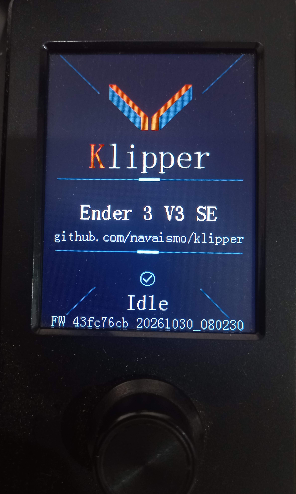
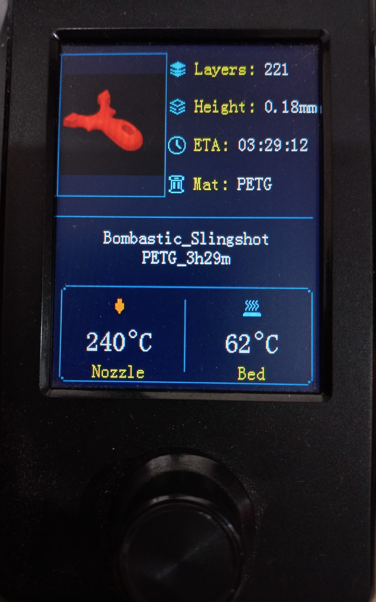
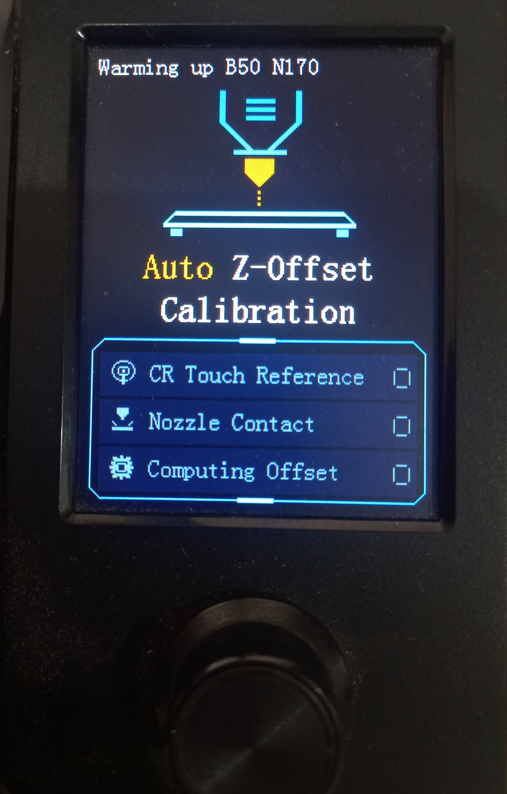
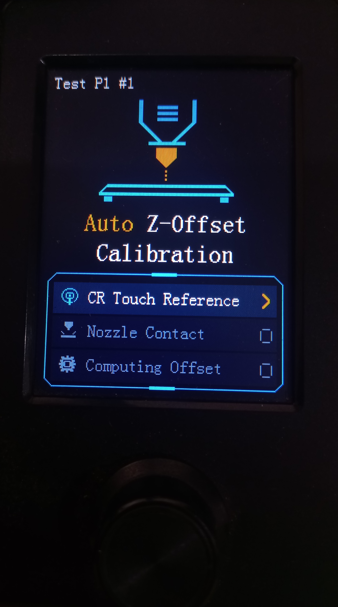
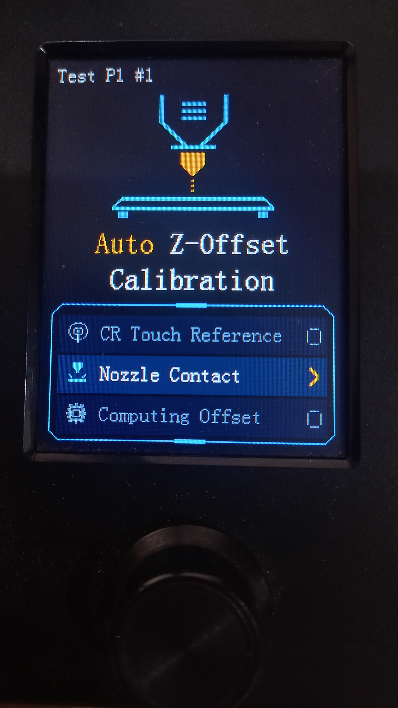

# Klipper for the Ender-3 V3 SE

A Klipper fork that reuses
the Ender-3 V3 SE's original TJC LCD while keeping it connected to the
mainboard. Validated on hardware with an STM32F103RET6 and TJC3224T1.

## Fork features

- A Klipper idle screen at startup and after a completed or cancelled job,
  once pending movements have finished. Its firmware line shows the revision
  and build timestamp reported by the connected mainboard. The repository URL
  stays in its original position; the firmware line uses small text at the
  bottom.
- An automatic job card before the first G-code: thumbnail, total layers,
  layer height, estimated duration in `hh:mm:ss`, material, filename and
  first-layer nozzle/bed temperature targets.
- Balanced, centered filename wrapping, yellow labels, cyan icons and
  temperature degree symbols. The displayed filename omits `.gcode`.
- 96×96 thumbnails with a 64-color palette. The host prepares RGB565 and
  transfers rectangles grouped by color when smaller, with raw RGB565 as
  a fallback. Transport compression preserves the prepared image pixels.
- Moonraker metadata collection and a C renderer on the mainboard's
  USART2. No LCD connection to the Raspberry Pi is required.
- On-demand automatic CR Touch Z-offset calibration using the stock load
  cell: paired measurements at a reference point and a validation point,
  force/error checks, explicit result acceptance and LCD phase highlights.

**These views are intentionally static to keep LCD work from interfering
with print quality.** The card is rendered before printing and remains
unchanged throughout the job, including pauses. There is no live progress,
current-layer or temperature polling/display. Nozzle and bed values are
first-layer targets from the file, not sensor readings; ETA is the total
estimated duration. The driver stops its UART and operation timer after
rendering. The screen provides no menus or printer controls.

## Hardware photos

| Idle screen | Print job card |
| --- | --- |
|  |  |

## Firmware build

Start with a working Klipper/Moonraker installation and the usual Klipper
firmware build environment. The Klippy service must use this complete
fork: copying only the extras does not install the hook that prepares the
card before printing.

```sh
git clone https://github.com/navaismo/klipper.git ~/klipper
cd ~/klipper
make menuconfig
```

If you already use this fork, work from the existing checkout. Save your
current `.config` and select the settings validated on this board:

| Setting | Value |
| --- | --- |
| Extra low-level configuration options | Enabled |
| Architecture | STMicroelectronics STM32 |
| Processor | STM32F103 |
| Bootloader | 28 KiB, application at `0x08007000` |
| Clock reference | 8 MHz crystal; MCU runs at 72 MHz |
| Klipper–mainboard communication | Serial USART1, PA10/PA9 |
| Klipper serial baud | 250000 |
| LCD | Enable `TJC LCD on USART2 PA2/PA3 (Ender-3 V3 SE)` |

The LCD option enables `CONFIG_TJC_LCD=y`. The screen uses USART2,
PA2 TX / PA3 RX, at 115200 baud, 8N1. On this board, the USB-C cable
between the Raspberry Pi and mainboard carries Klipper's USART1 serial
link; do not select USART2 for the host interface. PA2/PA3 are reserved
for the LCD.

```sh
make -j2
```

The output is `out/klipper.bin`. Install it using your board's usual
flashing procedure while the printer is idle. A minimal reference is
[test/configs/stm32f103-tjc.config](test/configs/stm32f103-tjc.config).
Update the host and MCU together; rendering requires firmware advertising
`TJC_JOB_VERSION=5`. This procedure does not update the LCD's own firmware.

## Host dependencies

Pillow is included in [scripts/klippy-requirements.txt](scripts/klippy-requirements.txt).
Installers and updaters that manage this file install it in Klippy's
Python environment. For a manual update, run from this checkout using
the service interpreter; with the standard virtual environment:

```sh
~/klippy-env/bin/python -m pip install -r scripts/klippy-requirements.txt
```

Adjust the path if your service uses another environment. No packages are
installed from a render callback. Without Pillow, text can still render,
but the thumbnail is unavailable and a warning is reported.

## printer.cfg setup

Keep your existing motor, sensor, MCU and macro configuration. Add these
sections, or update existing sections without duplicating them:

```ini
[tjc_lcd]
mcu: mcu
startup_delay: 1.0
handshake_timeout: 1.0

[lcd_status]
auto_prepare: True
moonraker_url: http://127.0.0.1:7125
request_timeout: 3.0
# moonraker_api_key: YOUR_API_KEY
```

Keep your existing `[virtual_sdcard]` section and G-code directory.
Adjust the URL for a different
Moonraker address and set an API key only if your installation requires
one. Do not add a `[display]` section for this screen or reassign PA2/PA3.
After deploying the firmware and modules, reload Klipper while the
printer is idle to load the new sections.

With `auto_prepare: True`, starting a job through Moonraker/Fluidd or
`M23`/`M24` prepares and renders the card before the first G-code. **Do not
add a script or `LCD_RENDER` call to `START_PRINT`.** A pause preserves the
card; completion or cancellation restores the idle screen after the
end/cancel macro and pending movements finish. Entering idle is also
handled without periodic redraws.

Enable PNG/JPEG thumbnails in your slicer so Moonraker can extract them
along with file metadata. When available, a source image of at least
192×192 is preferred and reduced to 96×96 on the host. A thumbnail failure
preserves a text-only card with warnings. Metadata or rendering errors
prevent the job from starting and report the problem for correction.

## Checking the display while idle

From Fluidd's G-code console:

```gcode
TJC_LCD_IDLE
LCD_PREPARE FILENAME="example.gcode"
LCD_RENDER FILENAME="example.gcode"
```

`LCD_PREPARE` only prepares data; `LCD_RENDER` prepares and draws without
starting a print. Replace the filename with an existing Moonraker file.
`TJC_LCD_INIT` repeats initialization and `TJC_LCD_CLEAR` clears the screen.
These commands reject requests while printing or paused. Warnings and
results are exposed through the `lcd_status` and `tjc_lcd` status objects.

Details and options: [LCD plan](docs/LCD_STATUS_PLAN.md),
[configuration](docs/Config_Reference.md#lcd_status),
[driver](docs/Config_Reference.md#tjc_lcd) and
[commands](docs/G-Codes.md#lcd_status).

## Automatic Z-offset calibration

> [!WARNING]
> **AUTOMATIC Z-OFFSET IS EXPERIMENTAL. VALIDATE BEFORE PRINTING.**
>
> The calculation is not perfect and may produce an inaccurate offset even
> when measurements are repeatable and all checks pass. Keep your known-good
> offset and verify nozzle-to-bed clearance before accepting or saving a new
> value. **AN INCORRECT OFFSET CAN DRIVE THE NOZZLE INTO THE BUILD SURFACE
> AND DAMAGE IT.**

CR Touch remains the primary probe for homing and bed mesh. The stock load
cell provides nozzle-contact measurements only to calculate its Z-offset;
it does not replace CR Touch or register another virtual endstop. Start
calibration on demand while the printer is idle and unpaused.
**Do not add it to PRINT_START, startup or KAMP.** Printing continues to use
the saved offset and the usual adaptive mesh.

The two-point workflow uses physical bed coordinates X28/Y28 near the cell
as P1, and X110/Y110 at the center as P2. Each CR Touch measurement is paired
with nozzle contact at the same physical point, accounting for probe XY
offsets. P1 supplies the candidate; P2 validates agreement without averaging.
The owner has completed two-point runs with LCD phase updates on hardware;
initial first-layer qualification remains separate from measurement success.
An investigation of a systematic difference from the working printing offset
is documented in the [diagnostic audit](docs/AUTO_Z_OFFSET_PLAN.md#systematic-offset-investigation-2026-10-30).
Keep the working offset; experimental candidates remain diagnostic-only until
the cause is understood. Repeatability alone does not establish accuracy.

### 1. Configure and check the load cell

Use this fork's host and matching MCU firmware, including HX711 acquisition
and analog-trigger support (`CONFIG_WANT_HX71X` and
`CONFIG_WANT_TRIGGER_ANALOG`, normally enabled). The ADC setup below has been
tested on the stock Ender-3 V3 SE board. Add it to `printer.cfg` or an included
file, keeping your existing `[bltouch]` and its working `z_offset`:

```ini
[load_cell bed_force]
sensor_type: hx711
sclk_pin: PA4
dout_pin: PC6
gain: A-128
sample_rate: 80
sensor_orientation: inverted
```

Configure the sensor only once. Do not add `[load_cell_probe]`; Auto Z-offset
reuses this named sensor and its calibration. After reloading Klipper while
idle, check acquisition without motion or nozzle contact:

```gcode
LOAD_CELL_DIAGNOSTIC LOAD_CELL=bed_force
LOAD_CELL_READ LOAD_CELL=bed_force
```

The diagnostic collects ten seconds of samples. Check for no acquisition
errors or saturation and a measured rate close to the configured 80 SPS.
Before calibration, `LOAD_CELL_READ` displays raw percentage and `---.-g`.
Apply and remove a small, controlled load at the sensing area to verify a
repeatable response; the reading must change when load is applied.

### 2. Calibrate the cell: tare first, then a known load

**Do not start nozzle-contact tests with guessed or copied calibration
values. TARE is essential:** it measures the unloaded reference used to
calculate `counts_per_gram` and to save `reference_tare_counts`.

Keep the normal build plate installed, the nozzle clear of the bed and the
printer stationary. Remove added weights and external pressure, then start
the guided session and take the unloaded reference:

```gcode
LOAD_CELL_CALIBRATE LOAD_CELL=bed_force
TARE
```

Wait for the tare response. Apply a stable load of known mass to the sensing
area near P1, without nozzle contact. Enter its actual mass in grams; for an
actual 1100 g calibration load, for example:

```gcode
CALIBRATE GRAMS=1100
```

Do not enter `1100` unless that is the load actually applied, and do not use
unmeasured hand pressure as a known mass. If Klipper reports identical
readings, less than 1% difference, saturation or another calibration error,
do not accept the result. Use `ABORT`, check load transfer and sensor response,
then repeat the guided calibration with an appropriate known load.

Only after `CALIBRATE` succeeds, accept the sensor calibration:

```gcode
ACCEPT
```

Klipper reports the measured `counts_per_gram` and `reference_tare_counts`
and stages them for saving. Remove the calibration weight, then persist them:

```gcode
SAVE_CONFIG
```

`SAVE_CONFIG` writes all pending settings to the active configuration and
restarts Klipper. The generated `[load_cell bed_force]` entry in the
SAVE_CONFIG block contains this printer's scale and unloaded reference.
Do not replace these with numbers from another printer or edit that block
by hand. This step calibrates the force sensor; it does not change CR Touch's
Z-offset.

After restart, with no added load, verify the calibrated sensor:

```gcode
LOAD_CELL_TARE LOAD_CELL=bed_force
LOAD_CELL_READ LOAD_CELL=bed_force
LOAD_CELL_DIAGNOSTIC LOAD_CELL=bed_force
```

The unloaded reading should be near zero, and an applied known load should
produce a corresponding positive gram reading. In this workflow, `TARE`,
`CALIBRATE`, `ACCEPT` and `ABORT` belong to the guided calibration session;
a standalone `TARE` otherwise returns "Unknown command". Outside that session,
`LOAD_CELL_TARE` adjusts the current zero only: **it does not calibrate the
scale or save a new `reference_tare_counts`.** Auto Z-offset performs its
own unloaded point-reference capture and local tares after warm-up; those
do not replace the saved sensor calibration.

### 3. Configure Auto Z-offset

Once sensor acquisition and calibration work, add:

```ini
[auto_z_offset]
load_cell: bed_force
probe_points:
    28, 28
    110, 110
speed: 0.5
lift_speed: 0.1
sample_retract_dist: 0.5
trigger_force: 75
force_safety_limit: 200
horizontal_move_z: 5
travel_speed: 50
z_hop_speed: 5
bed_temp: 50
nozzle_temp: 170
temperature_tolerance: 2
temperature_stable_time: 5
temperature_recovery_time: 10
heating_timeout: 600
offset_tolerance: 0.025
spatial_tolerance: 0.025
```

Speeds are in mm/s and forces are in grams. The contact speeds, retract
distance and 75/200 g thresholds above come from this printer's test setup;
they require local qualification, not just a successful config load.
Keep the established force limits when updating an already qualified setup.
`horizontal_move_z` must exceed the current probe offset. Both nozzle and
CR Touch positions must be reachable for each physical point. This workflow
does not support configured axis-twist, skew or thermal-Z compensation.

The temperature settings shown use the software defaults: bed/nozzle minima
are 50/170 C. Normal PID excursions pause warm-up accumulation or allow a
bounded recovery wait; changed targets and invalid readings reject the run.
Select tolerances for normal temperature variation, not to hide sensor faults.
The existing MCU analog trigger stops nozzle descent, while force, raw-range,
acquisition and contact-fit checks reject invalid measurements.

### 4. Run the automatic cycle and review the result

Reload Klipper while idle after adding the Auto Z-offset section. With a clean
nozzle, an unobstructed bed and an idle printer, run:

```gcode
AUTO_Z_OFFSET
```

Or explicitly select the calibration targets:

```gcode
AUTO_Z_OFFSET BED_TEMP=50 NOZZLE_TEMP=170
```

The command warms up, clears the mesh and performs full `G28`; no separate
homing or mesh clear is needed. It then runs two distinct measurement stages:

| Stage | P1 | P2 | Purpose |
| --- | --- | --- | --- |
| Contact test | 1 CR Touch/nozzle pair | 1 CR Touch/nozzle pair | Check contact acquisition at both locations before calibration. |
| Calibration | 3 fresh pairs | 3 fresh pairs | Calculate the candidate and validate repeatability and point agreement. |

**Calibration starts only if both contact tests pass.** The two preliminary
test pairs are excluded from the six-pair calibration result. Within each
pair, CR Touch can take several readings according to its configured
`[bltouch] samples`; three probe readings in the console do not mean three
independent contact tests.

Each local range must pass
`offset_tolerance`; the difference between point medians must pass
`spatial_tolerance`. P1's median is the candidate, and P2 only validates it.

**Any failed contact or invalid measurement stops the sequence:** it does not
continue with the next test/pair or accept the remaining samples. Force/raw
limits, acquisition errors, thermal failures, invalid contact fits and
excessive local/spatial spread reject the run. The error identifies the stage,
point/pair and reason.
Previous heater targets are restored on exit, the mesh stays cleared and the
existing offset remains active. KAMP can create a fresh mesh for the next
print as usual. Successful measurement leaves a candidate in memory only.

For initial qualification, keep a backup of the working configuration and
validate first-layer behavior before adopting a new offset.

To explicitly approve a validated candidate and then persist it:

```gcode
AUTO_Z_OFFSET_ACCEPT
SAVE_CONFIG
```

`AUTO_Z_OFFSET_ACCEPT` stages `[bltouch] z_offset`; it does not immediately
apply it. `SAVE_CONFIG` writes the staged value along with any other pending
settings and restarts Klipper. No measurement command automatically saves or
overwrites the working offset.

### Optional diagnostic commands

For separate supervised tests, home and clear the mesh first:

```gcode
G28
BED_MESH_CLEAR
AUTO_Z_OFFSET_TEST_CONTACT POINT=1 BED_TEMP=50 NOZZLE_TEMP=170
AUTO_Z_OFFSET_TEST_CONTACT POINT=2 BED_TEMP=50 NOZZLE_TEMP=170
AUTO_Z_OFFSET_CALIBRATE BED_TEMP=50 NOZZLE_TEMP=170
```

`TEST_CONTACT` takes one pair at the selected point without saving.
`CALIBRATE` takes three fresh pairs per point and requires both supervised
tests to have passed with unchanged references and no intervening homing or
restart. These manual commands retain the homed/inactive-mesh prerequisites.
They are alternatives for diagnosis; the normal `AUTO_Z_OFFSET` command
already includes their sequence and preparation. All measurement commands
accept the same optional bed/nozzle targets.

### LCD calibration views

The optional LCD calibration view highlights CR Touch Reference, Nozzle Contact
and Computing Offset without clearing the screen between phases. It requires
mainboard firmware with `TJC_CANVAS_VERSION=1` under the existing LCD build
option; the panel firmware and print-card protocol v5 are unchanged. The host
supplies bounded drawing coordinates, and each update completes before sensor
measurements. Only changed rows and the status strip are repainted; no LCD
traffic runs during sensor acquisition or contact fitting. These views run
only during idle calibration, never during a print.

| Warm-up | CR Touch reference | Nozzle contact |
| --- | --- | --- |
|  |  |  |

Further details: [setup and qualification](docs/AUTO_Z_OFFSET_PLAN.md),
[configuration](docs/Config_Reference.md#auto_z_offset),
[commands](docs/G-Codes.md#auto_z_offset) and
[load-cell configuration](docs/Config_Reference.md#load_cell).


---

## Original Klipper README

Welcome to the Klipper project!

[](https://www.klipper3d.org/)

https://www.klipper3d.org/

The Klipper firmware controls 3d-Printers. It combines the power of a
general purpose computer with one or more micro-controllers. See the
[features document](https://www.klipper3d.org/Features.html) for more
information on why you should use the Klipper software.

Start by [installing Klipper software](https://www.klipper3d.org/Installation.html).

Klipper software is Free Software. See the [license](COPYING) or read
the [documentation](https://www.klipper3d.org/Overview.html). We
depend on the generous support from our
[sponsors](https://www.klipper3d.org/Sponsors.html).
