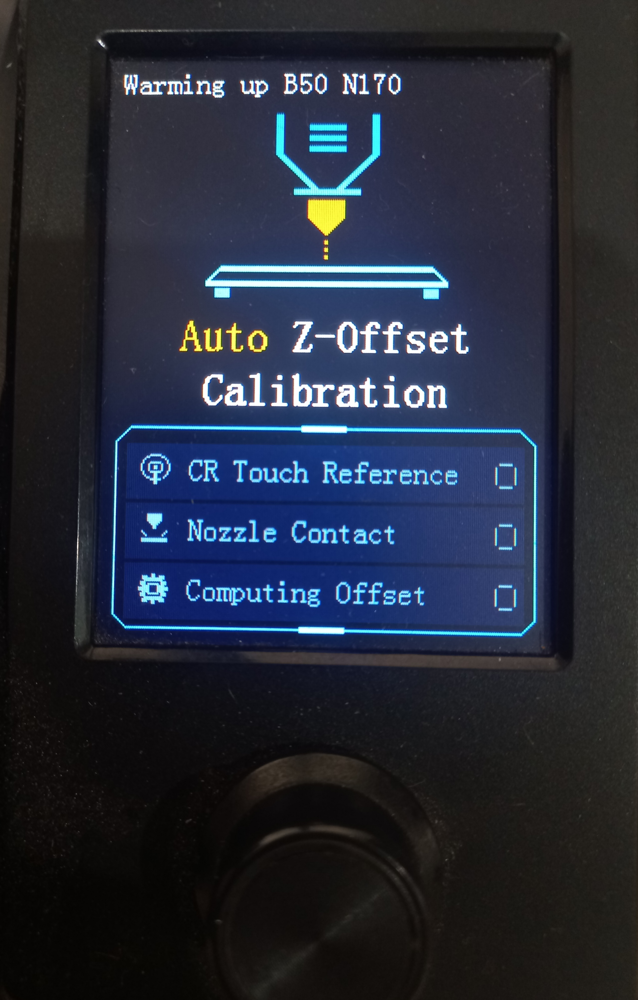
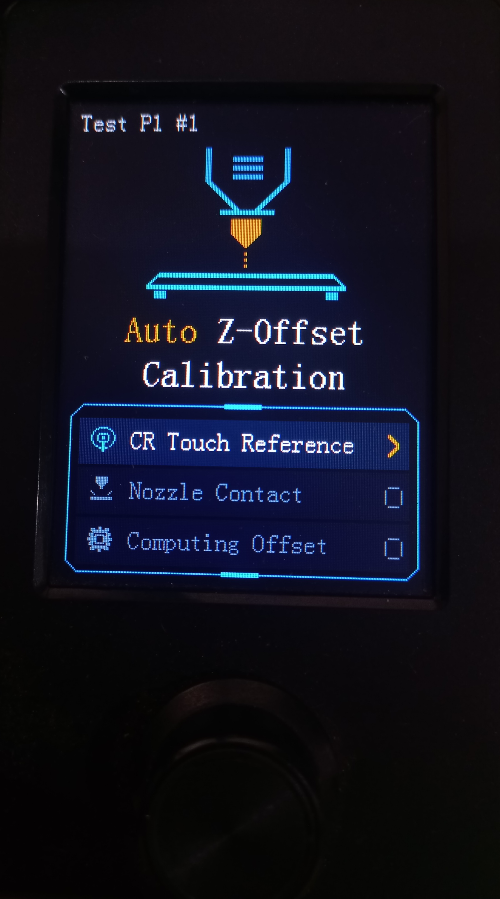
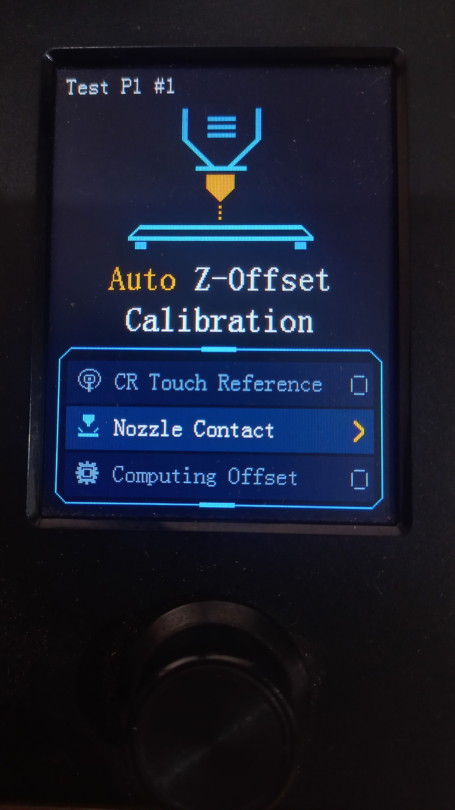

# Klipper for the Ender-3 V3 SE

I'm using this Klipper fork on my Ender-3 V3 SE to keep the original LCD
and knob working, with the screen still connected to the printer mainboard.
My setup uses an STM32F103RET6 mainboard and a TJC3224T1 display. Alongside
the LCD support, I'm working on automatic Z-offset calibration using
CR Touch and the stock load cell.

## What it adds

- An idle screen at startup and after a print finishes or is cancelled,
  with the connected MCU's firmware revision and build date below `Idle`.
- Knob menus for homing, preheating, moving each axis in 10 mm steps,
  and loading or unloading filament at 240 C. Press the knob to cancel
  a filament operation.
- A print card with a 120x120 thumbnail, layer count, layer height,
  estimated total time, material, filename and first-layer nozzle/bed
  targets. The card appears before printing starts, with `PRINTING` in orange.
- Press the knob during a print to run your configured `PAUSE` command.
  The card stays visible; resume from Fluidd or Moonraker.
- Automatic CR Touch Z-offset calibration and load-cell diagnostics,
  started manually while idle. This part is experimental; see the guide below.
- Screen layouts, colors, labels, artwork and navigation live on the host.
  Once the generic drawing firmware is installed, you can change the designs
  without reflashing the mainboard.

The print card stays unchanged while printing or paused. It shows the file's
estimated total time and temperature targets, with no live progress, layer,
remaining-time or heater updates. The Load/Unload screen shows the current
nozzle temperature while that operation runs with the printer idle.

The mainboard's C driver handles the LCD connection over USART2, serial
frames and drawing commands. The host prepares the screen content without
opening an LCD serial port.

## On my printer

Here are the idle screen, both menus and two print cards on my printer.


| Main menu | Movement submenu |
| --- | --- |
|  |  |

| Print card: skull case | Print card: slingshot |
| --- | --- |
|  |  |

## Setup

The [LCD and knob setup guide](docs/TJC_LCD_Setup.md) covers installation,
firmware settings, dependencies, commands, troubleshooting and rollback.
To get started:

1. Run the complete fork as your Klippy service. `feature/lcd_status`
   contains the LCD work; `feature/Auto_Z_offset` combines it with Z-offset
   development. Copying just the extras into upstream Klipper leaves out
   the virtual SD hooks needed to prepare the screen before a print.
2. Use mainboard firmware with `TJC_LCD_VERSION=1`, `TJC_JOB_VERSION=5`,
   `TJC_DRAW_VERSION=1`, and GPIO button support. For this board, keep the
   28 KiB bootloader, 8 MHz crystal and USART1 host settings. If your MCU
   already has these capabilities, the screen designs need no reflash.
3. Install [Klippy requirements](scripts/klippy-requirements.txt), including
   Pillow, in the running service's Python environment.
4. Include [sample-tjc-lcd.cfg](config/sample-tjc-lcd.cfg) once in the active
   printer configuration. It enables `[tjc_lcd]`, `[lcd_status]` and
   `[tjc_menu]`. Keep your existing virtual SD path and printer settings.
5. Reload Klipper while idle. Enable slicer PNG/JPEG thumbnails, preferably
   at least 192x192, and start prints normally from Fluidd/Moonraker.

Do not add LCD commands or scripts to `START_PRINT`. With the default
`auto_prepare: True`, metadata and all drawing complete before the first
file G-code runs. If metadata collection or rendering fails, the print
will not start. If only the thumbnail fails, you get a warning and a
text-only card. Thumbnails are prepared as 96x96 RGB565 images and displayed
at 120x120 without changing their colors.

My setup connects the host through USART1 PA9/PA10 at 250000 baud over the
mainboard's USB-C connection. The LCD uses USART2 PA2/PA3 at 115200 baud.
The knob pins are `encoder_pins: ^PA11, ^PA12` and `click_pin: ^!PB1`.
Do not assign them to other devices or enable a generic `[display]` driver
for this LCD.

## Knob operation

Turn the knob either way while the idle screen is visible to open the menu.
Turn clockwise to move down or counterclockwise to move up, then click to
open a submenu or run the selected action. Hold for 0.8 seconds to return
to Idle, following the `Press&Hold Knob: Idle Screen` hint. Clicking while
idle does nothing.

Fast turns are limited to one pending selection update, with a 200 ms
pause after each redraw to avoid building up a queue. Home, Preheat and
Movement leave the menu and highlight visible without redrawing after a
successful action. Home runs your configured `G28`; Preheat sets the bed
to 50 C and the nozzle to 170 C. Movement requires homed axes and enough
travel for the full 10 mm step. Front moves Y +10 mm; Back moves Y -10 mm.

Load heats to 240 C, feeds 50 mm at F800 and 40 mm at F400. Unload heats
to 240 C, purges 15 mm at F400 and retracts 90 mm at F800. Speeds are
mm/min. Press the knob to cancel: the active drawing transaction or queued
extrusion segment finishes first (at most 1 mm of extrusion), then the
nozzle turns off and the main menu returns. Completion and recoverable
errors also turn the nozzle off. The operation restores G-code state and
leaves the bed target unchanged.

During a print, each new debounced press runs `PAUSE` once. Rotations do
nothing during printing or pause, and clicks do nothing while paused.
Pause and filament-cancel clicks bypass the navigation delay. Resume from
Fluidd or your usual host UI. The full
[controls and action table](docs/TJC_LCD_Setup.md#knob-controls-and-actions)
describes the menu and its limits.

## Commands and diagnostics

To check a file while idle, run
`LCD_PREPARE FILENAME="parts/example.gcode"` to prepare its data, or
`LCD_RENDER FILENAME="parts/example.gcode"` to draw a test card without
starting a print. If the LCD previously failed, `LCD_RENDER` attempts to
initialize it again before drawing. The retry has a timeout and must
succeed before drawing starts. Automatic print preparation still blocks
printing if the LCD has failed.

Use `TJC_LCD_IDLE` to return to Idle and close the menu, `TJC_LCD_INIT`
to initialize the LCD, or `TJC_LCD_CLEAR COLOR=0` to clear it to black.
After initializing or clearing, wait for `tjc_lcd.state: ready`.
You can inspect `lcd_status`, `tjc_lcd` and `tjc_menu` through the printer
object API without triggering any action. Manual LCD commands are only
available when no job is printing or paused.

References: [setup and recovery](docs/TJC_LCD_Setup.md),
[configuration](docs/Config_Reference.md#lcd_status),
[commands](docs/G-Codes.md#lcd_status),
[status fields](docs/Status_Reference.md#lcd_status),
[architecture and history](docs/LCD_STATUS_PLAN.md).

## Automatic Z-offset calibration

> [!WARNING]
> **AUTOMATIC Z-OFFSET IS EXPERIMENTAL. VALIDATE BEFORE PRINTING.**
>
> The calculation is not perfect and may produce an inaccurate offset even
> when measurements are repeatable and all checks pass. Keep your known-good
> offset and verify nozzle-to-bed clearance before accepting or saving a new
> value. **AN INCORRECT OFFSET CAN DRIVE THE NOZZLE INTO THE BUILD SURFACE
> AND DAMAGE IT.**

CR Touch handles homing and bed mesh as usual. The stock load cell measures
nozzle contact to calculate the CR Touch Z-offset, without replacing the
probe or adding another virtual endstop. Start calibration manually while
the printer is idle and unpaused.
**Do not add it to PRINT_START, startup or KAMP.** Printing continues to use
the saved offset and the usual adaptive mesh.

The two-point workflow uses physical bed coordinates X28/Y28 near the cell
as P1, and X110/Y110 at the center as P2. Each CR Touch measurement is paired
with nozzle contact at the same physical point, accounting for probe XY
offsets. P1 supplies the candidate; P2 validates agreement without averaging.
I've completed two-point runs on my printer with the LCD showing each
calibration phase. A successful run still needs a first-layer check.
I'm investigating a systematic difference from the offset that works for
printing; the [diagnostic audit](docs/AUTO_Z_OFFSET_PLAN.md#systematic-offset-investigation-2026-10-30)
has the details. Keep your working offset while that difference is unresolved
and treat experimental results as diagnostic data. Repeatable measurements
can still give an inaccurate offset.

### 1. Configure and check the load cell

Use this fork's host and matching MCU firmware, including HX711 acquisition
and analog-trigger support (`CONFIG_WANT_HX71X` and
`CONFIG_WANT_TRIGGER_ANALOG`, normally enabled). The ADC setup below has been
tested on the stock Ender-3 V3 SE board. Add it to `printer.cfg` or an included
file, keeping your existing `[bltouch]` and its working `z_offset`:

```ini
[load_cell bed_force]
sensor_type: hx711
sclk_pin: PA4
dout_pin: PC6
gain: A-128
sample_rate: 80
sensor_orientation: inverted
```

Configure the sensor only once. Do not add `[load_cell_probe]`; Auto Z-offset
reuses this named sensor and its calibration. After reloading Klipper while
idle, check acquisition without motion or nozzle contact:

```gcode
LOAD_CELL_DIAGNOSTIC LOAD_CELL=bed_force
LOAD_CELL_READ LOAD_CELL=bed_force
```

The diagnostic collects ten seconds of samples. Check for no acquisition
errors or saturation and a measured rate close to the configured 80 SPS.
Before calibration, `LOAD_CELL_READ` displays raw percentage and `---.-g`.
Apply and remove a small, controlled load at the sensing area to verify a
repeatable response; the reading must change when load is applied.

### 2. Calibrate the cell: tare first, then a known load

**Do not start nozzle-contact tests with guessed or copied calibration
values. TARE is essential:** it measures the unloaded reference used to
calculate `counts_per_gram` and to save `reference_tare_counts`.

Keep the normal build plate installed, the nozzle clear of the bed and the
printer stationary. Remove added weights and external pressure, then start
the guided session and take the unloaded reference:

```gcode
LOAD_CELL_CALIBRATE LOAD_CELL=bed_force
TARE
```

Wait for the tare response. Apply a stable load of known mass to the sensing
area near P1, without nozzle contact. Enter its actual mass in grams; for an
actual 1100 g calibration load, for example:

```gcode
CALIBRATE GRAMS=1100
```

Do not enter `1100` unless that is the load actually applied, and do not use
unmeasured hand pressure as a known mass. If Klipper reports identical
readings, less than 1% difference, saturation or another calibration error,
do not accept the result. Use `ABORT`, check load transfer and sensor response,
then repeat the guided calibration with an appropriate known load.

Only after `CALIBRATE` succeeds, accept the sensor calibration:

```gcode
ACCEPT
```

Klipper reports the measured `counts_per_gram` and `reference_tare_counts`
and stages them for saving. Remove the calibration weight, then persist them:

```gcode
SAVE_CONFIG
```

`SAVE_CONFIG` writes all pending settings to the active configuration and
restarts Klipper. The generated `[load_cell bed_force]` entry in the
SAVE_CONFIG block contains this printer's scale and unloaded reference.
Do not replace these with numbers from another printer or edit that block
by hand. This step calibrates the force sensor; it does not change CR Touch's
Z-offset.

After restart, with no added load, verify the calibrated sensor:

```gcode
LOAD_CELL_TARE LOAD_CELL=bed_force
LOAD_CELL_READ LOAD_CELL=bed_force
LOAD_CELL_DIAGNOSTIC LOAD_CELL=bed_force
```

The unloaded reading should be near zero, and an applied known load should
produce a corresponding positive gram reading. In this workflow, `TARE`,
`CALIBRATE`, `ACCEPT` and `ABORT` belong to the guided calibration session;
a standalone `TARE` otherwise returns "Unknown command". Outside that session,
`LOAD_CELL_TARE` adjusts the current zero only: **it does not calibrate the
scale or save a new `reference_tare_counts`.** Auto Z-offset performs its
own unloaded point-reference capture and local tares after warm-up; those
do not replace the saved sensor calibration.

### 3. Configure Auto Z-offset

Once sensor acquisition and calibration work, add:

```ini
[auto_z_offset]
load_cell: bed_force
probe_points:
    28, 28
    110, 110
speed: 0.5
lift_speed: 0.1
sample_retract_dist: 0.5
trigger_force: 75
force_safety_limit: 200
horizontal_move_z: 5
travel_speed: 50
z_hop_speed: 5
bed_temp: 50
nozzle_temp: 170
temperature_tolerance: 2
temperature_stable_time: 5
temperature_recovery_time: 10
heating_timeout: 600
offset_tolerance: 0.025
spatial_tolerance: 0.025
```

Speeds are in mm/s and forces are in grams. The contact speeds, retract
distance and 75/200 g thresholds above are what I use for testing on my
printer. Check them on your own machine before relying on them; loading
the configuration successfully does not validate nozzle contact.
Keep the established force limits when updating an already qualified setup.
`horizontal_move_z` must exceed the current probe offset. Both nozzle and
CR Touch positions must be reachable for each physical point. This workflow
does not support configured axis-twist, skew or thermal-Z compensation.

The temperature settings above are the software defaults, with minimum
bed/nozzle targets of 50/170 C. Normal PID fluctuations pause the warm-up
timer or allow a limited wait for recovery. Changed targets or invalid
readings stop the run. Set the tolerance to accommodate normal temperature
variation without hiding sensor faults. The MCU analog trigger stops nozzle
descent, and force, raw-range, acquisition and contact-fit checks reject
invalid measurements.

### 4. Run the automatic cycle and review the result

Reload Klipper while idle after adding the Auto Z-offset section. With a clean
nozzle, an unobstructed bed and an idle printer, run:

```gcode
AUTO_Z_OFFSET
```

Or explicitly select the calibration targets:

```gcode
AUTO_Z_OFFSET BED_TEMP=50 NOZZLE_TEMP=170
```

The command warms up, clears the mesh and performs full `G28`; no separate
homing or mesh clear is needed. It then runs two distinct measurement stages:

| Stage | P1 | P2 | Purpose |
| --- | --- | --- | --- |
| Contact test | 1 CR Touch/nozzle pair | 1 CR Touch/nozzle pair | Check contact acquisition at both locations before calibration. |
| Calibration | 3 fresh pairs | 3 fresh pairs | Calculate the candidate and validate repeatability and point agreement. |

**Calibration starts only if both contact tests pass.** The two preliminary
test pairs are excluded from the six-pair calibration result. Within each
pair, CR Touch can take several readings according to its configured
`[bltouch] samples`; three probe readings in the console do not mean three
independent contact tests.

At each point, the spread between results must stay within
`offset_tolerance`. The difference between the two point medians must stay
within `spatial_tolerance`. P1's median becomes the candidate; P2 checks it.
Each pair estimates contact onset during descent, accounting for drift and
checking noise, correlation and the fitting window. Withdrawal measurements
help diagnose hysteresis but do not have to agree with descent for a candidate
to pass. If contact onset cannot be resolved, the run stops rather than
falling back to an older fit. Passing these checks does not prove accuracy.

**Any failed contact or invalid measurement stops the sequence:** it does not
continue with the next test/pair or accept the remaining samples. Force/raw
limits, acquisition errors, thermal failures, invalid contact fits and
excessive local/spatial spread reject the run. The error identifies the stage,
point/pair and reason.
Previous heater targets are restored on exit, the mesh stays cleared and the
existing offset remains active. KAMP can create a fresh mesh for the next
print as usual. Successful measurement leaves a candidate in memory only.

Before trying a new offset, back up your working configuration and plan to
watch the first layer. To try a valid normal candidate without saving it,
run:

```gcode
AUTO_Z_OFFSET_APPLY
```

This changes only the temporary native G-code Z correction, with no immediate
movement. It survives G28 in the current print-start macro. After ending or
cancelling the print and draining motion, restore the previous correction:

```gcode
AUTO_Z_OFFSET_ROLLBACK
```

Diagnostic, rejected or stale results cannot be applied. The saved probe
offset and load-cell calibration remain unchanged. Other macros that reset
G-code Z offsets can cancel the trial; restarting Klipper discards it.
See the [trial commands](docs/G-Codes.md#auto_z_offset_apply) for details.

Once you've checked a fresh validated candidate and want to save it, run:

```gcode
AUTO_Z_OFFSET_ACCEPT
SAVE_CONFIG
```

`AUTO_Z_OFFSET_ACCEPT` stages `[bltouch] z_offset`; it does not immediately
apply it. `SAVE_CONFIG` writes the staged value along with any other pending
settings and restarts Klipper. No measurement command automatically saves or
overwrites the working offset.

### Optional diagnostic commands

For separate supervised tests, home and clear the mesh first:

```gcode
G28
BED_MESH_CLEAR
AUTO_Z_OFFSET_TEST_CONTACT POINT=1 BED_TEMP=50 NOZZLE_TEMP=170
AUTO_Z_OFFSET_TEST_CONTACT POINT=2 BED_TEMP=50 NOZZLE_TEMP=170
AUTO_Z_OFFSET_CALIBRATE BED_TEMP=50 NOZZLE_TEMP=170
```

`TEST_CONTACT` takes one pair at the selected point without saving.
`CALIBRATE` takes three fresh pairs per point without requiring prior manual
contact tests. These manual commands retain the homed/inactive-mesh
prerequisites and qualify each fresh acquired contact before use.
They are alternatives for diagnosis; the normal `AUTO_Z_OFFSET` command
already includes their sequence and preparation. All measurement commands
accept the same optional bed/nozzle targets.

### LCD calibration views

The optional calibration screen highlights CR Touch Reference, Nozzle Contact
and Computing Offset as the run progresses. It updates changed rows and the
status strip without clearing the screen between phases.

It needs mainboard firmware with `TJC_CANVAS_VERSION=1` or the menus'
`TJC_DRAW_VERSION=1` under the LCD build option. If you already have the
generic drawing firmware for the menus, no reflash is needed. The panel
firmware and print-card protocol v5 stay the same.

The host prepares each screen update, which finishes before the sensor
measurements begin. There is no LCD traffic during sensor acquisition or
contact fitting, and these screens only appear during idle calibration.

| Warm-up | CR Touch reference | Nozzle contact |
| --- | --- | --- |
|  |  |  |

Further details: [setup and qualification](docs/AUTO_Z_OFFSET_PLAN.md),
[configuration](docs/Config_Reference.md#auto_z_offset),
[commands](docs/G-Codes.md#auto_z_offset) and
[load-cell configuration](docs/Config_Reference.md#load_cell).

---

## Original Klipper README

Welcome to the Klipper project!

[](https://www.klipper3d.org/)

https://www.klipper3d.org/

The Klipper firmware controls 3d-Printers. It combines the power of a
general purpose computer with one or more micro-controllers. See the
[features document](https://www.klipper3d.org/Features.html) for more
information on why you should use the Klipper software.

Start by [installing Klipper software](https://www.klipper3d.org/Installation.html).

Klipper software is Free Software. See the [license](COPYING) or read
the [documentation](https://www.klipper3d.org/Overview.html). We
depend on the generous support from our
[sponsors](https://www.klipper3d.org/Sponsors.html).
