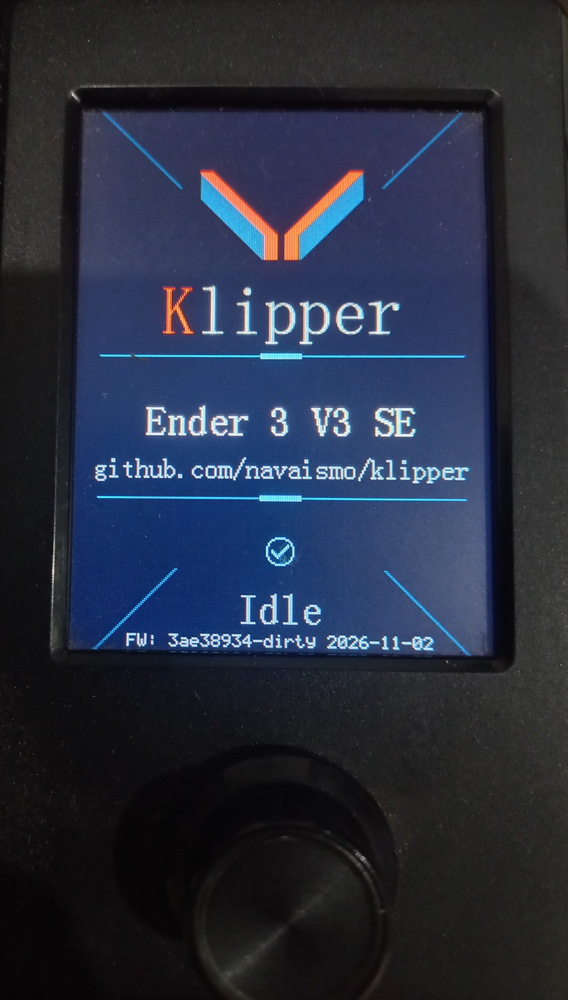
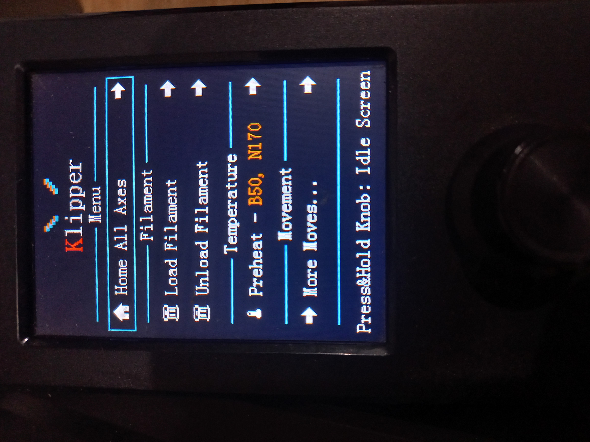
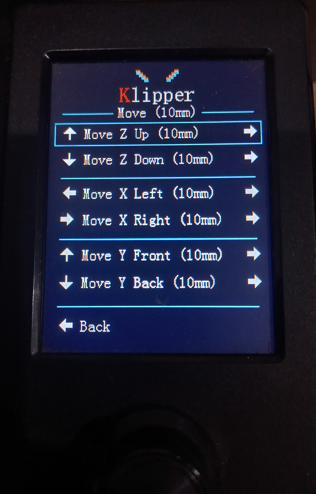
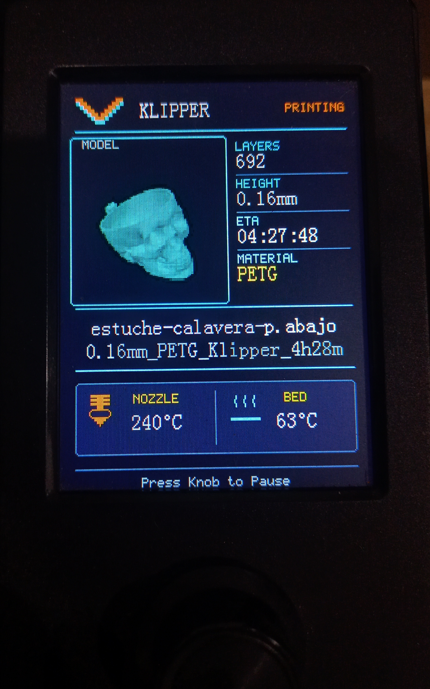
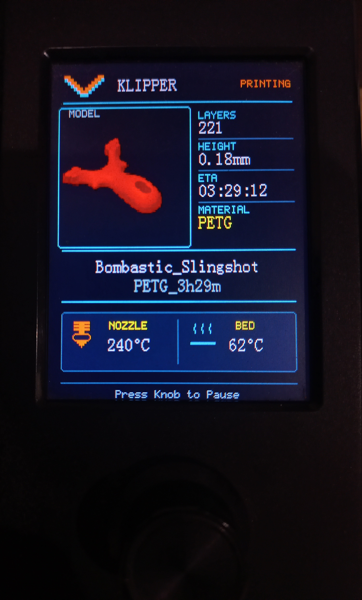

# Klipper for the Ender-3 V3 SE

This Klipper fork reuses the original TJC LCD and knob while keeping the
screen connected to the printer mainboard. The owner confirmed the current
appearance on an STM32F103RET6 mainboard with a TJC3224T1 display; the
photos below show this setup on hardware.

## Fork features

- Idle screen at startup and after completed/cancelled jobs, with the
  connected MCU's firmware revision and compilation date below `Idle`.
- Host-designed knob menus for homing, preheating, 10 mm XYZ movements,
  and filament loading/unloading at 240 C with press-to-cancel support.
- A static card rendered before the first print G-code: 120x120 displayed
  thumbnail, layers, layer height, estimated total duration, material,
  wrapped filename and first-layer nozzle/bed targets. `PRINTING` is orange.
- A debounced knob press during printing runs the configured `PAUSE`
  command once. The card stays visible; resume through Fluidd/Moonraker.
- Screen designs, colors, labels, artwork and navigation stay on the host.
  Once generic drawing firmware is installed, visual updates need no flash.

**The print card is intentionally static.** There is no live progress,
current-layer, remaining-time or temperature refresh during printing or
pause. Card temperatures come from the file, not heater readings. Only an
active idle Load/Unload operation refreshes changed nozzle temperatures.
The mainboard C driver owns LCD USART2, framing and bounded drawing work;
the host never opens an LCD serial port.

## Hardware photos

These owner-supplied photos replace the earlier idle/card examples. They
show the current idle footer, both menus and two print cards. They confirm
appearance, not measured rendering time or print-quality impact.

| Main menu | Movement submenu |
| --- | --- |
|  |  |

| Print card: skull case | Print card: slingshot |
| --- | --- |
|  |  |

## Setup

Follow the [complete LCD and knob setup guide](docs/TJC_LCD_Setup.md)
for first installation, firmware settings, dependencies, configuration,
commands, troubleshooting, updates and rollback.

The required setup is:

1. Run this complete fork in the Klippy service. The current development
   branch is `feature/lcd_status`; copying only extras into upstream
   Klipper does not install the virtual SD hooks.
2. Use mainboard firmware with `TJC_LCD_VERSION=1`, `TJC_JOB_VERSION=5`,
   `TJC_DRAW_VERSION=1`, and GPIO button support. Keep the confirmed 28 KiB
   bootloader, 8 MHz crystal and USART1 host settings. An already compatible
   MCU needs no reflash for these new designs.
3. Install [Klippy requirements](scripts/klippy-requirements.txt), including
   Pillow, in the running service's Python environment.
4. Include [sample-tjc-lcd.cfg](config/sample-tjc-lcd.cfg) once in the active
   printer configuration. It enables `[tjc_lcd]`, `[lcd_status]` and
   `[tjc_menu]`; retain the existing virtual SD path and printer settings.
5. Reload Klipper while idle. Enable slicer PNG/JPEG thumbnails, preferably
   at least 192x192, and start prints normally from Fluidd/Moonraker.

Do not add LCD commands or scripts to `START_PRINT`. With the default
`auto_prepare: True`, metadata and all drawing complete before the first
file G-code. Metadata/render failures prevent start; thumbnail failures
allow a text-only card and report warnings. The prepared 96x96 RGB565 image
is displayed at 120x120 with its colors preserved.

The working host link is USART1 PA9/PA10 at 250000 baud over the mainboard's
USB-C connection. LCD USART2 reserves PA2/PA3 at 115200 baud. The knob pins
are `encoder_pins: ^PA11, ^PA12` and `click_pin: ^!PB1`. Do not assign them
to other devices or enable a generic `[display]` driver for this LCD.

## Knob operation

Turn either way from visible Idle to open Menu. Clockwise highlights the
next entry down; counterclockwise highlights the previous entry. Click to
enter/execute. Hold for 0.8 seconds to return to Idle, as indicated by
`Press&Hold Knob: Idle Screen`. An idle click does nothing.

Fast turns share one pending redraw, with a 200 ms cooldown after the
previous draw completes. Successful Home, Preheat and Movement actions
keep the menu/highlight without redrawing. Home uses the configured `G28`;
preheat sets bed 50 C/nozzle 170 C. Movement requires homing and a full
in-range 10 mm destination; Front is Y +10 mm and Back is Y -10 mm.

Load heats to 240 C, feeds 50 mm at F800 and 40 mm at F400. Unload heats
to 240 C, purges 15 mm at F400 and retracts 90 mm at F800. Speeds are
mm/min. `Press to cancel` stops after the active drawing transaction or
queued extrusion segment (at most 1 mm), turns the nozzle off and returns
to Menu. Completion and recoverable errors also turn the nozzle off;
G-code state is restored and the bed target is unchanged.

During printing only a fresh debounced press runs `PAUSE`; rotations and
paused clicks do nothing. Pause/cancel clicks do not use the navigation
cooldown. Resume through the normal host UI. The full
[controls and action table](docs/TJC_LCD_Setup.md#knob-controls-and-actions)
describes the menu and its limits.

## Commands and diagnostics

While idle, `LCD_PREPARE FILENAME="parts/example.gcode"` prepares data only;
`LCD_RENDER FILENAME="parts/example.gcode"` draws a test card without
starting a print. After an LCD error, explicit idle `LCD_RENDER` retries
bounded initialization before drawing; automatic print preparation still
rejects a failed LCD. No timeout is accepted as success.

`TJC_LCD_IDLE` restores Idle and closes the menu. `TJC_LCD_INIT` requests
initialization; `TJC_LCD_CLEAR COLOR=0` requests a black clear. Wait for
`tjc_lcd.state: ready` after initialization/clear. Inspect `lcd_status`,
`tjc_lcd` and `tjc_menu` through the usual printer object API; reads are
passive. All manual LCD commands reject printing/paused jobs.

References: [setup and recovery](docs/TJC_LCD_Setup.md),
[configuration](docs/Config_Reference.md#lcd_status),
[commands](docs/G-Codes.md#lcd_status),
[status fields](docs/Status_Reference.md#lcd_status),
[architecture and history](docs/LCD_STATUS_PLAN.md).

---

## Original Klipper README

Welcome to the Klipper project!

https://www.klipper3d.org/

The Klipper firmware controls 3d-Printers. It combines the power of a
general purpose computer with one or more micro-controllers. See the
[features document](https://www.klipper3d.org/Features.html) for more
information on why you should use the Klipper software.

Start by [installing Klipper software](https://www.klipper3d.org/Installation.html).

Klipper software is Free Software. See the [license](COPYING) or read
the [documentation](https://www.klipper3d.org/Overview.html). We
depend on the generous support from our
[sponsors](https://www.klipper3d.org/Sponsors.html).
