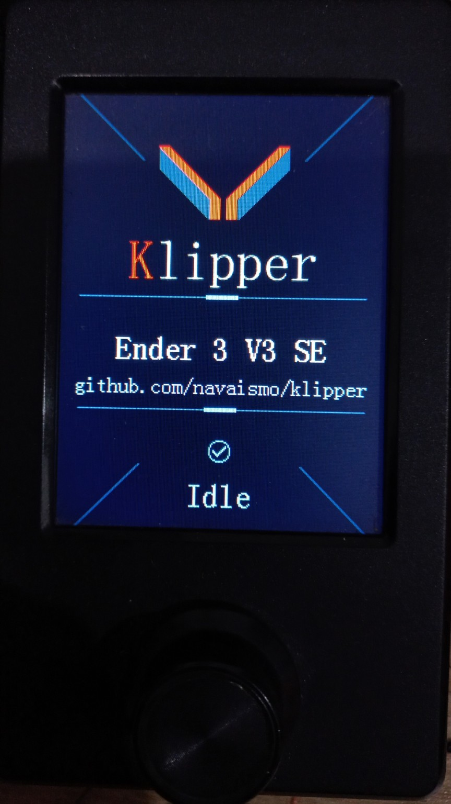

# Klipper for the Ender-3 V3 SE 

A klipper fork that reuses
the Ender-3 V3 SE's original TJC LCD while keeping it connected to the
mainboard. Validated on hardware with an STM32F103RET6 and TJC3224T1.

## Fork features

- A Klipper idle screen at startup and after a completed or cancelled job,
  once pending movements have finished.
- An automatic job card before the first G-code: thumbnail, total layers,
  layer height, estimated duration in `hh:mm:ss`, material, filename and
  first-layer nozzle/bed temperature targets.
- Balanced, centered filename wrapping, yellow labels, cyan icons and
  temperature degree symbols. The displayed filename omits `.gcode`.
- 96×96 thumbnails with a 64-color palette. The host prepares RGB565 and
  transfers rectangles grouped by color when smaller, with raw RGB565 as
  a fallback. Transport compression preserves the prepared image pixels.
- Moonraker metadata collection and a C renderer on the mainboard's
  USART2. No LCD connection to the Raspberry Pi is required.

**These views are intentionally static to keep LCD work from interfering
with print quality.** The card is rendered before printing and remains
unchanged throughout the job, including pauses. There is no live progress,
current-layer or temperature polling/display. Nozzle and bed values are
first-layer targets from the file, not sensor readings; ETA is the total
estimated duration. The driver stops its UART and operation timer after
rendering. The screen provides no menus or printer controls.

## Hardware photos

| Idle screen | Print job card |
| --- | --- |
|  |  |

## Firmware build

Start with a working Klipper/Moonraker installation and the usual Klipper
firmware build environment. The Klippy service must use this complete
fork: copying only the extras does not install the hook that prepares the
card before printing.

```sh
git  https://github.com/navaismo/klipper.git ~/klipper
cd ~/klipper
make menuconfig
```

If you already use this fork, work from the existing checkout. Save your
current `.config` and select the settings validated on this board:

| Setting | Value |
| --- | --- |
| Extra low-level configuration options | Enabled |
| Architecture | STMicroelectronics STM32 |
| Processor | STM32F103 |
| Bootloader | 28 KiB, application at `0x08007000` |
| Clock reference | 8 MHz crystal; MCU runs at 72 MHz |
| Klipper–mainboard communication | Serial USART1, PA10/PA9 |
| Klipper serial baud | 250000 |
| LCD | Enable `TJC LCD on USART2 PA2/PA3 (Ender-3 V3 SE)` |

The LCD option enables `CONFIG_TJC_LCD=y`. The screen uses USART2,
PA2 TX / PA3 RX, at 115200 baud, 8N1. On this board, the USB-C cable
between the Raspberry Pi and mainboard carries Klipper's USART1 serial
link; do not select USART2 for the host interface. PA2/PA3 are reserved
for the LCD.

```sh
make -j2
```

The output is `out/klipper.bin`. Install it using your board's usual
flashing procedure while the printer is idle. A minimal reference is
[test/configs/stm32f103-tjc.config](test/configs/stm32f103-tjc.config).
Update the host and MCU together; rendering requires firmware advertising
`TJC_JOB_VERSION=5`. This procedure does not update the LCD's own firmware.

## Host dependencies

Pillow is included in [scripts/klippy-requirements.txt](scripts/klippy-requirements.txt).
Installers and updaters that manage this file install it in Klippy's
Python environment. For a manual update, run from this checkout using
the service interpreter; with the standard virtual environment:

```sh
~/klippy-env/bin/python -m pip install -r scripts/klippy-requirements.txt
```

Adjust the path if your service uses another environment. No packages are
installed from a render callback. Without Pillow, text can still render,
but the thumbnail is unavailable and a warning is reported.

## printer.cfg setup

Keep your existing motor, sensor, MCU and macro configuration. Add these
sections, or update existing sections without duplicating them:

```ini
[tjc_lcd]
mcu: mcu
startup_delay: 1.0
handshake_timeout: 1.0

[lcd_status]
auto_prepare: True
moonraker_url: http://127.0.0.1:7125
request_timeout: 3.0
# moonraker_api_key: YOUR_API_KEY
```

`path` must match your G-code directory; keep the existing value if
`[virtual_sdcard]` is already configured. Adjust the URL for a different
Moonraker address and set an API key only if your installation requires
one. Do not add a `[display]` section for this screen or reassign PA2/PA3.
After deploying the firmware and modules, reload Klipper while the
printer is idle to load the new sections.

With `auto_prepare: True`, starting a job through Moonraker/Fluidd or
`M23`/`M24` prepares and renders the card before the first G-code. **Do not
add a script or `LCD_RENDER` call to `START_PRINT`.** A pause preserves the
card; completion or cancellation restores the idle screen after the
end/cancel macro and pending movements finish. Entering idle is also
handled without periodic redraws.

Enable PNG/JPEG thumbnails in your slicer so Moonraker can extract them
along with file metadata. When available, a source image of at least
192×192 is preferred and reduced to 96×96 on the host. A thumbnail failure
preserves a text-only card with warnings. Metadata or rendering errors
prevent the job from starting and report the problem for correction.

## Checking the display while idle

From Fluidd's G-code console:

```gcode
TJC_LCD_IDLE
LCD_PREPARE FILENAME="example.gcode"
LCD_RENDER FILENAME="example.gcode"
```

`LCD_PREPARE` only prepares data; `LCD_RENDER` prepares and draws without
starting a print. Replace the filename with an existing Moonraker file.
`TJC_LCD_INIT` repeats initialization and `TJC_LCD_CLEAR` clears the screen.
These commands reject requests while printing or paused. Warnings and
results are exposed through the `lcd_status` and `tjc_lcd` status objects.

Details and options: [LCD plan](docs/LCD_STATUS_PLAN.md),
[configuration](docs/Config_Reference.md#lcd_status),
[driver](docs/Config_Reference.md#tjc_lcd) and
[commands](docs/G-Codes.md#lcd_status).

## Repository and updates

This checkout's `origin` points to
`https://github.com/navaismo/klipper.git` for fetch and push. `upstream`
identifies the original project and is retained for synchronization.
Configure updaters to use this fork and the branch containing LCD support;
updating directly from upstream does not include these features.

---

## Original Klipper README

Welcome to the Klipper project!

[](https://www.klipper3d.org/)

https://www.klipper3d.org/

The Klipper firmware controls 3d-Printers. It combines the power of a
general purpose computer with one or more micro-controllers. See the
[features document](https://www.klipper3d.org/Features.html) for more
information on why you should use the Klipper software.

Start by [installing Klipper software](https://www.klipper3d.org/Installation.html).

Klipper software is Free Software. See the [license](COPYING) or read
the [documentation](https://www.klipper3d.org/Overview.html). We
depend on the generous support from our
[sponsors](https://www.klipper3d.org/Sponsors.html).
